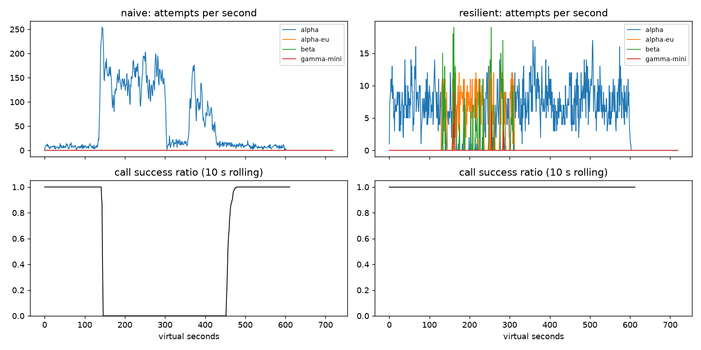

# Lab 25B — Report

**Họ tên / nhóm:** Nguyễn Hồng Thái / 2A202602894  
**Commit:** 5086bca3e4f48e7142faafbf44a70aff9b469f67 (code and evaluation artifacts)
**Điểm tự động (`make grade`):** 84 / 88

## 1. Kết quả Game Day (naive vs của bạn)

| Băng | Client | availability | p95 (s) | amplification | retry_ratio | cost/turn | recovery (s) | PASS? |
|---|---|---:|---:|---:|---:|---:|---:|:---:|
| G1 | naive | 0.7194 | 7.157 | 7.738 | 6.738 | 2.163 | 4 | Không |
| G1 | yours | 1.0000 | 4.790 | 1.061 | 0.002 | 2.100 | 0 | Có |
| G2 | naive | 0.4560 | 15.034 | 9.904 | 8.904 | 4.627 | 155 | Không |
| G2 | yours | 1.0000 | 12.029 | 1.061 | 0.007 | 2.151 | 0 | Có |
| G3 | naive | 1.0000 | 4.768 | 1.164 | 0.164 | 2.328 | 0 | Không |
| G3 | yours | 1.0000 | 4.660 | 1.060 | 0.034 | 2.145 | 0 | Có |
| G4 | naive | 1.0000 | 13.764 | 1.004 | 0.004 | 2.008 | 0 | Không |
| G4 | yours | 1.0000 | 5.562 | 1.015 | 0.002 | 2.072 | 0 | Có |
| G5 | naive | 0.3699 | 5.359 | 17.030 | 16.030 | 2.124 | — | Không |
| G5 | yours | 0.8179 | 5.477 | 1.003 | 0.002 | 2.504 | — | Có |
| G6 | naive | 0.5170 | 4.836 | 12.344 | 11.344 | 2.009 | 0 | Không |
| G6 | yours | 0.9505 | 5.977 | 1.025 | 0.011 | 2.234 | 0 | Có |

## 2. Cấu hình client và lý do

| Tham số | Giá trị | Vì sao |
|---|---:|---|
| attempt_timeout_s | 8.0 s | G6 cần phát hiện deployment treo sớm để failover trong deadline 30 s. |
| max_attempts_per_provider | 2 | Tối đa một retry cùng provider; sáu băng đạt yêu cầu với amplification 1.003–1.061. |
| backoff_base_s / cap_s | 0.25 / 4.0 s | Full jitter phân tán retry; 0 vi phạm retry-after ở G1. |
| retry_budget_ratio | 0.1 | Với breaker cố ý tắt ở G2, budget giảm amplification 1.672→1.383 và retry_ratio 0.491→0.058. |
| breaker.window_size / min_calls | 20 / 10 | Đủ mẫu để tránh mở breaker do vài lỗi rời rạc; xét cửa sổ gần nhất. |
| breaker.failure_rate_threshold | 0.5 | Mở breaker khi tối thiểu nửa cửa sổ lỗi. |
| breaker.slow_call_s | 5.0 s | G4 chậm thêm 5 s; failover giữ p95 ở 5.562 s. |
| breaker.open_duration_s | 10.0 s | Tạm ngưng deployment lỗi rồi thăm dò phục hồi. |
| breaker.half_open_max_probes | 2 | Giới hạn probe đồng thời khi phục hồi. |

Quyết định lỗi: lỗi 400 nhả permit và dừng; quota 429 đặt cooldown quota và failover; rate-limit 429 tôn trọng retry-after qua cooldown dùng chung rồi failover; overload, server error và timeout được ghi vào breaker và chỉ retry cùng provider nếu còn lượt, budget và deadline, nếu không thì failover.

## 3. Ba thí nghiệm

1. **Retry budget.** Với breaker bị vô hiệu hóa và tối đa 5 attempt/provider, G2 bật budget đạt availability 99.87%, amplification 1.383, retry_ratio 0.058, recovery 0 s; tắt budget lần lượt là 96.49%, 1.672, 0.491, 30 s. Ở G3 retry_ratio giảm từ 0.162 xuống 0.068 khi bật budget. Breaker tốt giảm nhu cầu dùng budget, nhưng budget vẫn hạn chế khuếch đại tải khi breaker cấu hình sai hoặc nhiều deployment suy giảm cùng lúc.

2. **Timeout 30 s.** G6 chỉ đạt availability 88.26%, với 117 call hết deadline và 163 call không còn provider; p95 của call thành công là 5.177 s. G4 gần như không đổi: availability 100%, p95 5.683 s, không GiveUp vì provider vẫn trả lời. Timeout nên dành đủ thời gian cho ít nhất một lần failover trong deadline người dùng, căn cứ vào p99 bình thường và thời gian xử lý của provider.

3. **Bỏ lọc tool calling.** Trên G6, bỏ lọc làm 258 call đi tới model không hỗ trợ tool và availability giảm còn 89.18%. Người dùng không nhận được hành động cần thiết vì yêu cầu cần tool bị gửi tới model chỉ có khả năng chat.

## 4. Workflow hoàn tiền

| Executor | completion | crashes | duplicate refunds | duplicate emails | lost refunds | overpaid | wasted LLM / crash |
|---|---:|---:|---:|---:|---:|---:|---:|
| naive | 100% | 81 | 128 | 81 | 0 | 1,496,700¢ | 1.123 |
| yours | 100% | 66 | 0 | 0 | 0 | 0¢ | 0.303 |

Idempotency key ngăn side effect chạy hai lần nhưng không cho worker biết bước nào đã hoàn tất; checkpoint cho phép resume nhưng không ngăn payment lặp lại khi response mất trước checkpoint. Ghi checkpoint trước payment có thể làm workflow bỏ qua payment sau crash và khiến khách không được hoàn tiền.

## 5. Alerting & error budget

| Sự cố | Mong đợi | Naive alerter | Burn-rate alerter | Độ trễ phát hiện |
|---|---|---|---|---:|
| checkout_bug | page | page | page | 27 phút |
| provider_outage | page | page | page | 4 phút |
| deploy_blip | none | page nhầm | none | — |
| slow_leak | ticket | bỏ sót | ticket | 1,337 phút |
| degraded_evening | page | page | page | 291 phút |
| night_spike | none | page nhầm | none | — |
| small_bump | none | page nhầm | none | — |

30 ngày có 25,901,755 request và 55,618 request lỗi. SLO 99.5% cho phép 129,508.8 lỗi; đã dùng 42.95%, còn 57.05%, nên chưa đóng băng release. `small_bump` kéo dài 20 phút ở mức lỗi 12% chưa đốt ngân sách đủ nhanh để đánh thức on-call; luật nhiều cửa sổ bỏ qua blip nhưng vẫn tạo ticket cho rò rỉ chậm.

## 6. Postmortem — Băng G2 với client naive

**Tóm tắt:** Alpha mất 75% GPU trong ba phút, làm tăng độ trễ và tạo hàng đợi quá tải. Ba tầng retry cố định tạo 34,475 attempt cho 2,362 lượt user; chỉ 1,077 lượt thành công. Alpha phục hồi tại giây 300 nhưng tỷ lệ thành công chỉ trở lại 95% ở giây 455.

**Ảnh hưởng:** 1,285/2,362 lượt user thất bại (54.4%). Suy giảm bắt đầu ở giây 120; phục hồi ở giây 455, tức 155 giây sau khi alpha khỏe lại. Nếu chỉ có sự cố này trong tháng, lượng lỗi tương đương khoảng 10,880% error budget (108.8 lần ngân sách tương ứng 2,362 lượt).

**Timeline** (giây ảo):

| t | Sự kiện | Bằng chứng từ CSV |
|---:|---|---|
| 0–119 | Trước sự cố | 895/895 call thành công; khoảng 7.5 attempt/s |
| 120 | Alpha mất 75% năng lực | Trong giây 120 có 5 attempt; 120–149 chỉ 51/98 call thành công |
| 150–299 | Retry storm giữ hàng đợi đầy | 0/631 call thành công; 21,979 attempt, trung bình 146.5/s |
| 300 | Alpha hồi phục hoàn toàn | Tới hết giây 359 chỉ 0/169 call thành công |
| 360–454 | Hệ thống vẫn suy giảm | Chỉ 8/385 call thành công; 6,447 attempt (67.9/s) |
| 455 | Đạt lại ngưỡng phục hồi | 291/307 call thành công trong 455–479 |
| 480–599 | Trở về bình thường | 986/986 call thành công; khoảng 8.0 attempt/s |

**Trigger và nguyên nhân gốc:** Trigger là alpha mất 75% GPU. Nguyên nhân gốc là retry lồng ba tầng, delay cố định, không budget và không breaker. Timeout client không hủy việc đang chờ ở server; retry mới tiếp tục lấp hàng đợi và chiếm slot sau khi GPU phục hồi, khiến request mới timeout. Vòng lặp kéo dài thêm 155 giây.

**Điều giúp / điều làm tệ hơn:** Thời hạn chờ server giới hạn request treo. Retry đồng loạt nhiều tầng và công việc tiếp tục chạy sau timeout làm sự cố tệ hơn.

**Action items:**

| # | Hành động | Loại | Owner | Cách kiểm chứng |
|---|---|---|---|---|
| 1 | Chỉ retry transient tại một tầng, thêm full jitter và retry budget | prevent | Agent platform | G2 CI amplification ≤ 1.6 |
| 2 | Breaker sliding window, slow call và probe HALF-OPEN có giới hạn | mitigate | Reliability | G2 recovery ≤ 30 s qua nhiều seed |
| 3 | Alert khi amplification > 1.6 hoặc availability dưới SLO | detect | On-call | Fault injection xác nhận alert trước khi cạn error budget |

## 7. Một điểm yếu còn lại

G2 đạt availability 100% và recovery 0 s ở seed công khai, nhưng p95 là 12.029 s, cao với nhiều tương tác dù thấp hơn deadline cứng 30 s. Có thể cải thiện bằng deadline con cho từng bước hoặc spillover sớm hơn sang beta; cần cân đối p95 với chi phí beta qua nhiều seed.

## 8. Cache (Part G)

| Client | availability | faq_availability | cache_hit_ratio | stale_served | wrong_answers | outdated_answers | cost/turn | PASS? |
|---|---:|---:|---:|---:|---:|---:|---:|:---:|
| resilient (không cache) | 0.8373 | 0.8424 | 0.000 | 0 | 0 | 0 | 1.386 | Không |
| cached (của bạn) | 0.9117 | 0.9640 | 0.579 | 152 | 0 | 4 | 0.965 | Có |

| Tham số cache | Giá trị | Vì sao |
|---|---:|---|
| similarity_threshold | 0.97 | 0.80 gây 175 câu sai loại other_question; 0.97 không có câu sai. |
| ttl_s | 60 | TTL 30 cho hit ratio 49.5%; TTL 300 gây 95 câu lỗi thời; TTL 60 gây 4. |
| max_stale_s | 300 | Stale bằng 0 làm FAQ availability còn 87.5%; 300 giữ 96.4% qua outage 120 giây. |

1. **Ngưỡng.** Ở 0.80, hit ratio 65.9% nhưng có 175 câu hỏi khác bị trả nhầm, FAQ availability còn 86.05%. Ở 0.97, hit ratio 57.9%, không câu sai và cost/turn là 0.965; lợi ích tăng hit không đáng để đánh đổi tính đúng.

2. **TTL.** TTL 30/60/300 giây cho hit ratio 49.5%/57.9%/70.1% và câu cũ 2/4/95. Webhook xử lý thay đổi được thông báo; thay đổi phí ship im lặng không có webhook nên TTL giới hạn độ cũ của câu trả lời.

3. **Stale-if-error.** `max_stale_s: 0` làm FAQ availability giảm từ 96.4% xuống 87.5%, hit ratio còn 49.4% và không có stale answer. Cửa sổ 300 giây phục vụ 152 stale answer trong outage.

Câu hỏi cá nhân không được cache vì trạng thái đơn hàng, hoàn tiền và điểm thưởng thay đổi; cache riêng theo user vẫn có thể đưa thông tin riêng đã cũ thành trạng thái hiện thời. Khi cache giữ dashboard xanh trong outage, alert cần theo dõi sức khỏe provider qua error/timeout rate, cùng cache hit ratio và stale-served để nhận ra backend đang lỗi.

